**BOB DEMO-BUILDER MODE**
# **IBMers | SETUP AND REGISTRATION**

---

## **i. Overview**


!!! note ""
    Christopher Bienko *(AI Enablement GTM Product Manager)* provides an overview of the *Setup and registration* curriculum for Bob Demo Builder hands-on enablement. **<a href="https://ibm.seismic.com/Link/Content/DCCPbp4FRQHP2G9P3WQFWPMMTGcj" target="_blank">[1 min]</a>**

This page is written for **IBM regular employees**. Business Partners should follow the companion page, **[Business Partners | Setup and registration](1-2.md){:target="_blank"}**, which registers through IBM Technology Zone and obtains the Demo Builder as a packaged download from Seismic.

Within this chapter, you will assemble the Bob Demo-Builder environment end-to-end:

- Register for **IBM Bob** through the Internal registration route and authenticate the Bob IDE on your local machine
- Install the **Client Engineering (CE) Bob Marketplace** extension via the *Agentic Sidebar* and create the **GitHub Personal Access Token (PAT)** that unlocks its catalog
- Install the **IBM Pre-Sales Demo Builder** collection into a fresh project workspace: the packaged Mode together with its Skills, Rules, and MCP configuration that the remainder of this lab runs upon
- Verify the workspace, so that the *IBM Pre-Sales Demo Builder* mode is available within the Agentic Sidebar before any demo work begins
- Optionally, acquire the short-lived credentials for (and configure) the **Carbon** and **TechZone** MCP servers. The hands-on build in the next chapter runs in mock mode and does not depend upon them.

This process is a relatively quick one, so long as you don't stray too far from the documentation. **Do not** attempt to install the *CE Bob Marketplace* via an *Extensions* search — you will come up empty handed. Follow the instructions as-written (below) in order to properly configure the environment.

---

## **ii. Prerequisites**

<p align="left">

</p>
!!! note ""
    The illustration above serves as a one page map of the setup work ahead. Follow along in the subsequent steps for detailed, step-by-step guidance (with links and highlighted screen captures throughout.)

Ensure that you have each of the following prerequisites in hand before embarking on the lab setup. Two minutes of checks now will save you an hour of troubleshooting later.

!!! success "BEFORE YOU BEGIN"
    - Valid **w3id** credentials
    - Administrative rights to install software on your local machine
    - A Cisco AnyConnect VPN connection to the **IBM Intranet**
    - An account on **github.ibm.com**, or a personal GitHub account linked to the IBM GitHub organization (section *iv*, *Step 2*)

!!! warning "A GITHUB ACCOUNT IS REQUIRED"
    The CE Bob Marketplace catalog is served from the IBM GitHub (enterprise) organization. Without an account on **github.ibm.com** you cannot generate the personal access token that unlocks it. If you are unable to obtain access, you can still complete this lab. Download the Demo Builder as a packaged workspace from Seismic instead by following **[section iv of the Business Partners page](1-2.md#iv-download-the-demo-builder-package-from-seismic){:target="_blank"}**, then return to section *viii* of this page to verify the workspace.

!!! note "ALREADY HAVE IBM BOB?"
    If the Bob IDE is already installed and authenticated on your machine, skip section *iii* and jump ahead to section *iv*.

---

## **iii. Internal registration**

The Internal registration route is the appropriate one for IBM regular employees. It grants a general-purpose IBM Bob account tied to your w3id, which is all this lab requires.

!!! note "PREMIUM PACKAGES"
    The *IBM Bob Premium Packages* (for i, for Z, and for Java) are requested by IBMers separately via **<a href="https://w3.ibm.com/w3publisher/bob/addons" target="_blank">https://w3.ibm.com/w3publisher/bob/addons</a>**. None of them are required for this lab.

---

1. Begin at the **<a href="https://techzone.ibm.com/collection/bob-enterprise-sales-assets" target="_blank">Bob Enterprise Sales Assets</a>** page on IBM Technology Zone.

    Once there, click **Technical Resources** in the left sidebar.

    <p align="left">
    
    </p>

---

2. Click **See it** under the *"Internal Bob Sign Up"* tile.

    <p align="left">
    
    </p>

---

3. You will be redirected to a sign-up form. Enter all of the requested information and press **Submit.**

    <p align="left">
    
    </p>

---

4. Review your responses if you like, then confirm by clicking **Submit** once more in the pop-up window.

    There will be a *"Thank you"* pop-up that appears afterward — you can simply dismiss it.

    <p align="left">
    
    </p>

---

5. After submission, you will receive a confirmation email.

    <p align="left">
    
    </p>

---

6. At this point you will need to wait — as noted, approval typically takes at least 24 hours.

    Once approved, you will receive an email — follow the **Download Bob** hyperlink within it.

    <p align="left">
    
    </p>

---

7. The *Download Bob* link opens a Box folder containing download links for various operating systems. Locate the version appropriate for your OS and click it.

    <p align="left">
    
    </p>

---

8. Click the appropriate file within the folder.

    <p align="left">
    
    </p>

---

9. Click **Download**.

    <p align="left">
    
    </p>

---

10. Review the License Agreement, and if you accept its terms and conditions, toggle `I accept the agreement` and press **Next.**

    <p align="left">
    
    </p>

---

11. Continue through the GUI-based install process common to most desktop software — review the instructions on each Setup page to configure Bob to your liking, and press **Next** to proceed.

    <p align="left">
    
    </p>

---

12. Installation should take roughly 5–10 minutes.

    <p align="left">
    
    </p>

---

13. A completion pop-up appears.

    Tick **Launch IBM Bob** (if it is not already checked) and press **Finish**.

    <p align="left">
    
    </p>

---

14. IBM Bob opens. Click **Log in to Bob**.

    <p align="left">
    
    </p>

---

15. When prompted *The extension IBM Bob wants to sign in using Bob.*, click **Allow** to launch a web browser for authentication.

    Log in within the browser using your *IBMid* and *password* - those which are linked to the IBM Bob account you registered for in the previous steps.

    <p align="left">
    
    </p>

---

16. A few additional prompts may arise before authentication can complete:

    - If asked *"Do you want to allow this website to open IBM Bob?"*, click **Yes**
    - Wait until the web browser refreshes to read *Authentication Successful!* before closing the browser window
    - Return to the Bob IDE, which has now been successfully authenticated and connected to the IBM Bob service

    <p align="left">
    
    </p>

---

With IBM Bob authenticated, continue to section *iv* to install the CE Bob Marketplace extension.

---

## **iv. Install the CE Bob Marketplace extension**

The work ahead proceeds in four phases:

- Install the Marketplace extension (this section)
- Create the GitHub PAT that authenticates it (section *v*)
- Register your token with the extension (section *vi*)
- Instantiate the Demo Builder within a new Project workspace (section *vii*)

??? info "Want to learn more about the **CE Bob Marketplace** extension?"
    Additional documentation is available from the IBM GitHub repository. Be aware that you will need to link your personal GitHub account to the IBM GitHub organization before you can access the repository (*Step 2*, below).

    !!! warning ""
        **<a href="https://github.ibm.com/ClientEngineering/bob/tree/main/How-To/Bob-Marketplace" target="_blank">https://github.ibm.com/ClientEngineering/bob/tree/main/How-To/Bob-Marketplace</a>**

The *IBM Client Engineering Bob Marketplace Extension* currently supports two options for installing the extension within the Bob IDE: *Automated* (recommended option) and *Manual*.

For simplicity, this lab guide will follow the **<a href="https://github.ibm.com/ClientEngineering/bob/tree/main/How-To/Bob-Marketplace#method-a--automated-install-recommended" target="_blank">Automated</a>** installation procedure; however, documentation for the **<a href="https://github.ibm.com/ClientEngineering/bob/tree/main/How-To/Bob-Marketplace" target="_blank">Manual</a>** approach is also available online.

---

1. Ensure your machine is connected via a Cisco AnyConnect VPN to the **IBM Intranet**.

    !!! warning ""
        Without a VPN or Intranet connection, the necessary extensions (such as the *CE Bob Marketplace*) will not display the necessary collections and many of the fields will be marked as unreachable or empty.

---

2. Create an **IBM GitHub** account — or request to link your *personal* GitHub account to the *IBM* GitHub (enterprise) organization. This is a hard requirement: the personal access token created in section *v* cannot be generated without it.

    Personal accounts on GitHub will not be able to access repositories stored on the IBM GitHub (enterprise) organization without first requesting access. To link a personal GitHub account to the IBM GitHub organization, you will require valid **IBMid** credentials.

    - In order to request access, first visit the following website (ensure your VPN connection is active):

        !!! warning ""
            **<a href="https://gh-user-map.opensource.dal.app.cirrus.ibm.com" target="_blank">https://gh-user-map.opensource.dal.app.cirrus.ibm.com</a>**

    - Under the **Account Linking** header, locate the *IBM GitHub Enterprise* tile
    - Click the blue **Authenticate** button and supply your IBMid credentials, as well as details about your personal GitHub account name
    - You may be emailed to join the IBM GitHub organization, if you were not previously a member. Please accept the invitation and await confirmation before attempting to log in.

    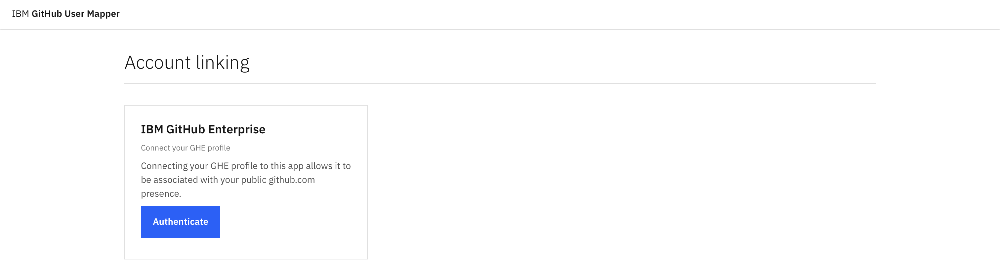

    !!! warning ""
        *NOTE:* **Two-factor authentication** (2FA) must be enabled under your *GitHub security settings* before you can join an IBM organization.

    ??? failure "TROUBLESHOOTING: UNABLE TO ACCESS GITHUB OR REQUEST ACCESS"
        - If you are unable to access the IBM GitHub organization or request access, first make sure that your VPN connection is active.
        - If the problem persists, download the Demo Builder as a packaged workspace from Seismic instead — **[section iv of the Business Partners page](1-2.md#iv-download-the-demo-builder-package-from-seismic){:target="_blank"}** — and then return to section *viii* of this page. All the necessary files and lab assets arrive as a ZIP folder, which bypasses the GitHub requirement entirely.

---

3. To initiate the **Automated** install path, open the **Bob IDE** and click the **Open Bob** icon from the top of the interface (located just to the right of the top-center search bar). This will open the **Agentic Sidebar** along the right-side of the Bob IDE.

    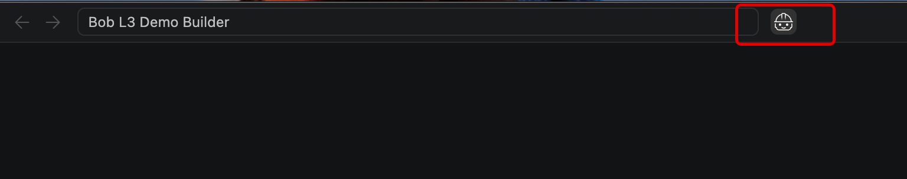

---

4. Ensure that the **Agent** mode is active within the mode switch toggle.

    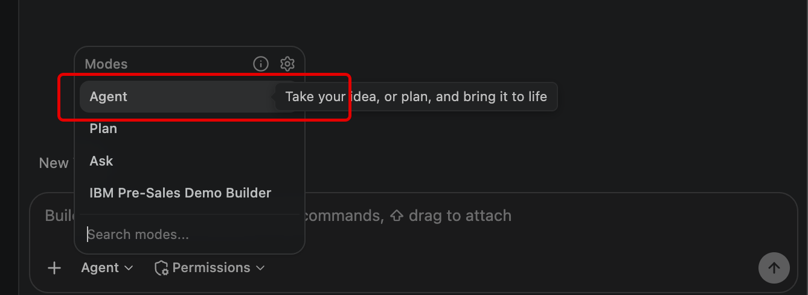

---

5. Select from the two options below according to your machine's operating system.

    Copy the command line string to your clipboard and then paste into the Agentic Sidebar session, hitting ++return++ to execute the task.

    ??? info "LINUX / MAC"
        ```
        curl -fsSL https://s3.eu-de.cloud-object-storage.appdomain.cloud/bob-marketplace/marketplace-install-mac-linux.sh | bash
        ```
    
    ??? info "WINDOWS"
        ```
        powershell -ExecutionPolicy Bypass -Command "iwr https://s3.eu-de.cloud-object-storage.appdomain.cloud/bob-marketplace/marketplace-install-win.sh -UseBasicParsing | iex"
        ```

---

6. Bob will pause at a *Tools awaiting approval:* checkpoint before running anything. In the documented run, Bob declined to pipe the installer straight into a shell. Instead, it proposed downloading the script to a temporary file and reading it in full before deciding whether to execute it.

    Review the proposed *Execute Command* and click **Approve** to let Bob retrieve the script.

    !!! quote "AGENTIC SIDEBAR OUTPUT"
        ```
        I'll download the script and read it before running it, rather than piping it straight into bash.

        $ curl -fsSL https://s3.eu-de.cloud-object-storage.appdomain.cloud/bob-marketplace/marketplace-install-mac-linux.sh -o /tmp/marketplace-install.sh && wc -l /tmp/marketplace-install.sh && cat /tmp/marketplace-install.sh
        242 /tmp/marketplace-install.sh
        #!/bin/bash
        # Installer for the "Bob PreSales DEMO Builder Marketplace" Bob IDE extension.
        # macOS / Linux. Designed to be pasted into Bob Chat (Advanced mode) and run.
        #
        # It downloads the extension VSIX from public IBM Cloud Object Storage
        # (no API key required), unpacks it into Bob's user extensions folder, and
        # registers it so Bob loads it on next launch.
        #
        # Usage:
        #   curl -fsSL <this-script-url> | bash
        #   ./marketplace-install-mac-linux.sh [--file <local.vsix>] [--url <vsix-url>]
        ```

    Bob's review of the script (roughly 240 lines in total) establishes two facts worth knowing before you approve its execution:

    - The script installs a Bob IDE extension and nothing else.
    - It reads your Bob login email from a local settings database and prints it to the terminal. It does **not** transmit the email anywhere.

---

7. Bob also searches the IBM Bob documentation for guidance on installing Marketplace extensions by script. The documentation describes installation through the in-app Marketplace and a separate `bob.ibm.com` script for *Bob Shell*. It does not mention this installation route or the hosting bucket.

    The source should therefore be confirmed as trusted by the person running the installation. In this case, the source is a trusted (IBM Client Engineering) one, so this is simply an instance of Bob being vigilant against potential security threats.

    !!! warning ""
        The Cloud Object Storage bucket hosting the installer is not an official `bob.ibm.com` location. Confirm that you trust where a link came from before approving any script's execution — a habit worth keeping well beyond this lab.

---

8. Approve the *Execute Command* checkpoint for running the saved script. Bob executes it locally, and the script performs the following operations in order:

    | OPERATION | WHAT HAPPENS |
    | --------- | ------------ |
    | **Environment check** | Verifies that Bob is installed by locating Bob's configuration directories under your home directory. Reports the Bob IDE version (for example `1.126.0+bob2.2.1`) and the logged-in user email. |
    | **Package download** | Retrieves the extension package (a `.vsix` file, which is a zip archive) from the public bucket. Confirms the file is a valid zip archive and not an error page. |
    | **Extraction** | Unpacks the package into a temporary directory and reads the extension manifest to identify the publisher, name, and version. |
    | **Installation** | Removes any earlier versions of the extension, then moves the new version into `~/.bobide/extensions/`. |
    | **Registration** | Adds an entry for the extension to `~/.bobide/extensions/extensions.json` so that Bob loads it at startup. |

    When finished, Bob reports that the **Bob PreSales DEMO Builder Marketplace** extension (`ibm-ce.bob-marketplace`, version `0.19.0` at the time of writing) has been installed.

    !!! quote "AGENTIC SIDEBAR OUTPUT"
        ```
        The "Bob PreSales DEMO Builder Marketplace" extension (v0.19.0, ibm-ce.bob-marketplace) is installed. To use it, fully quit and reopen Bob, then look for "Bob Powers" in the sidebar. I haven't opened it, so I can't say whether it loads correctly.
        ```

    Bob did not inspect the contents of the extension itself, and it did not launch the extension to verify that it loads correctly. The script ran only the download and unpack operations described above. Verifying that the extension loads is a check you will perform yourself in the next two steps.

---

9. Fully **quit** (completely close and exit) the Bob IDE, then **restart** the application. The extension registers at startup, so a full relaunch is required before it becomes visible.

---

10. Look for **CE Bob Marketplace** in the *Activity Bar* (the left-hand icon strip). The extension contributes a view container titled *CE Bob Marketplace*. It activates automatically after startup, so it should be visible as soon as the Bob IDE finishes restarting.

    !!! warning "BOB POWERS?"
        IBM Bob, while executing *Steps 6* through *8* (above), may mistakenly refer to a "Bob Powers" extension. There is no such extension - it is a mislabeling of the correct "CE Bob Marketplace" extension. If you were to drill into questioning Bob about "what are Bob Powers?" you'll also find it arrives at the same conclusion: the extension you've installed, and the one that should be visible from the left-hand taskbar, is the "CE Bob Marketplace."

    ??? failure "TROUBLESHOOTING: PERMISSION CHECKS, WORKSPACE ERRORS, OR A MISSING TAB"
        Your run may unfold differently from the one documented above. Participants running Bob for the first time have reported the following sequence instead, as Bob establishes the necessary permissions to access directories and folders on the local machine.

        - Bob prompts a *Tools awaiting approval:* checkpoint describing the *Execute Command* as one that `downloads a shell script from a remote URL and pipes it directly into 'bash', executing code from an untrusted source`. Toggle on the **I understand the risk** button to the right of the *Security Warning* prompt and click **Approve** to continue.

        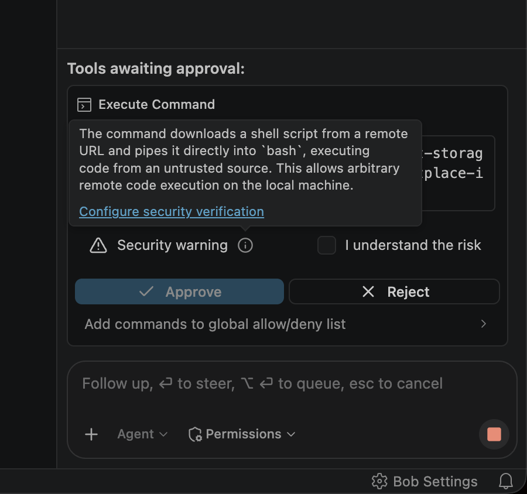{ width="450" }

        - Bob may then return a **`Command failed`** complaint: `The workspace directory doesn't exist yet, which is preventing the shell from starting. Let me run this from the home directory instead.` Further down the session, another *Execute Command* approval request (this time for `cwd .`) will be pending. Check the **I understand the risk** toggle box and click **Approve** to continue.

        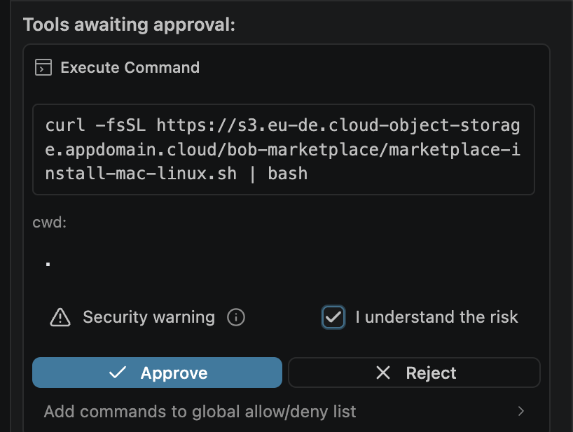{ width="450" }

        - A further *Command failed* prompt may follow, with an error similar to: `The shell cannot start because the workspace directory /Users/.../.bob/playground does not exist on disk.` Bob will suggest *within the Agentic Sidebar* a command that you can run directly within the Bob IDE Terminal. Be sure to use the one that Bob suggests for *your* machine.

            - **Copy** the command from the Agentic Sidebar chat to your clipboard
            - Open a new Terminal by clicking **Terminal** > **New Terminal** from the top menu bar (or by pressing ++ctrl+shift+grave++ as a shortcut)
            - **Paste** the command into the Terminal console and hit ++return++ to execute

            After a moment, the Terminal console should report back that it has `Installed Bob PreSales DEMO Builder Marketplace` and that you should `Fully quit and reopen Bob..` before continuing further. Quit and restart the Bob IDE to expose the newly-installed extension.

        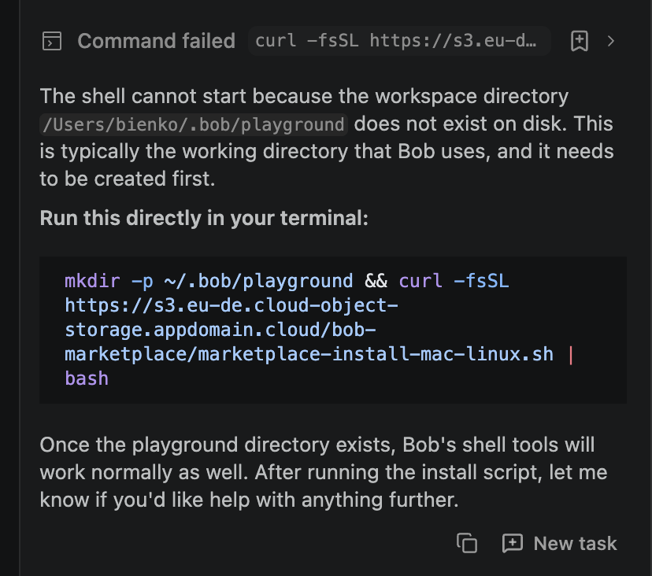{ width="450" }

        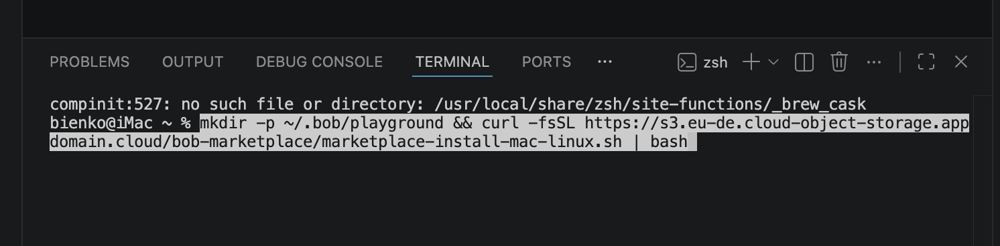{ width="450" }

        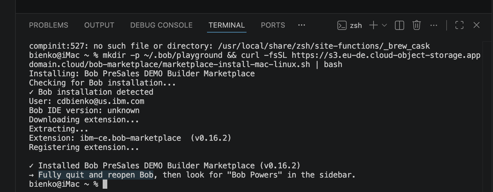{ width="450" }

        - If, upon restarting, the CE Bob Marketplace tab is still not visible along the left-hand side: return to the Agentic Sidebar session. You can directly click on previous sessions within here to resume where you last left off.

            - Within the previous session's chat, enter the text **`Continue`** and hit ++return++
            - Bob will likely report that `The workspace directory now exists (since you're continuing), let me try the command again.`
            - If prompted with an *Execute Command* checkpoint, check the **I understand the risk** box and click **Approve** to continue
            - Wait until Bob reports back a successful `Installation complete` summary
            - **Exit** and **restart** the Bob IDE once again to apply the changes

        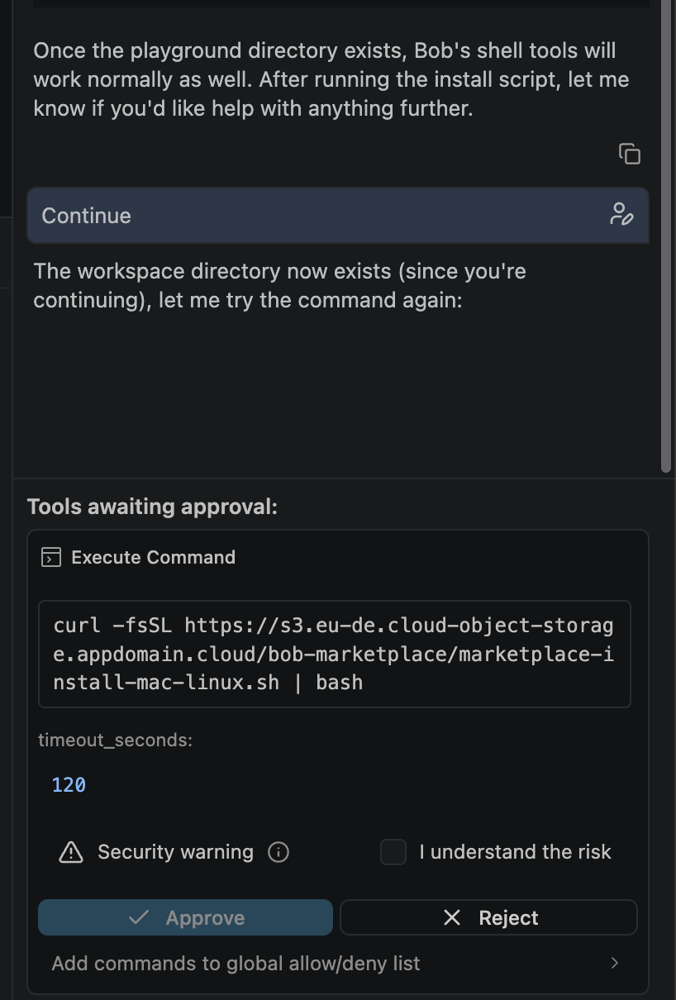{ width="450" }

        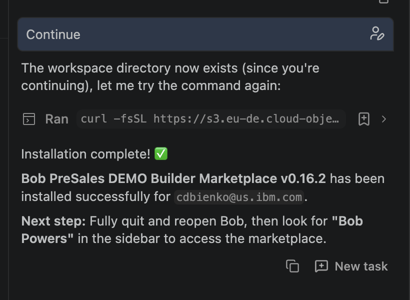{ width="450" }

---

## **v. Configure a personal access (GitHub API) token**

The **CE Bob Marketplace** requires a valid *GitHub Enterprise API Token* in order to expose the Marketplace catalog contents. As mentioned previously, you will need to have linked your personal GitHub account to the IBM GitHub organization (section *iv*, *Step 2*) before you can access the IBM GitHub page.

---

1. First, you'll want to generate a new **Personal Access Token (PAT)** — otherwise known as a *GitHub Enterprise API Token*.

    Open a web browser and navigate to the following website:

    !!! warning ""
        **<a href="https://github.ibm.com/settings/tokens/new" target="_blank">https://github.ibm.com/settings/tokens/new</a>**

---

2. Fill out the **New personal access token (classic)** request form according to the following (recommended) specifications to create a new *Personal Access Token (PAT)* that will serve as your *GitHub Enterprise API Token*.

    | FIELD | SET TO |
    | ----- | ------ |
    | `Note` | A unique name of your choosing |
    | `Expiration` | 90 days |
    | `Scopes` | Check the `repo` option (all subitems under `repo` will automatically be enabled) |

    All other fields should remain *off* (their default values). When ready, scroll down to the bottom of the page and click **Generate token** to proceed.

    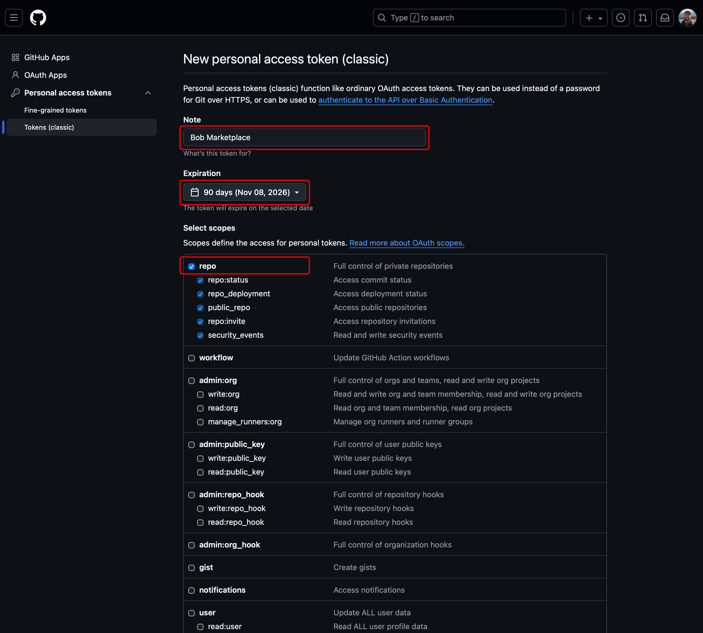

    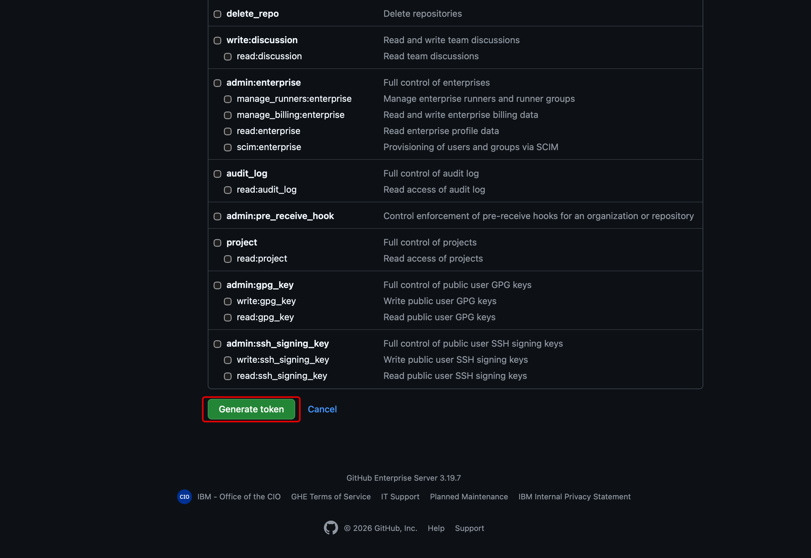

---

3. **Copy** the PAT to your clipboard and **save** it to a notepad for future reference. You will not be able to look up the key once you have navigated away from this screen, but you can always regenerate a new one in future if needed.

---

## **vi. Authenticate the CE Bob Marketplace extension**

With your *PAT / GitHub Enterprise API Token* in hand, it's time to authenticate the extension within the Bob IDE.

---

1. From the relaunched Bob IDE, click the newly-installed **CE Bob Marketplace** tab from the left-hand side of the interface. Double-check that your VPN connection is active.

    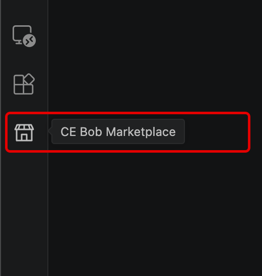

---

2. Click the **key** icon labelled *Bob Marketplace: Set Repository Token* within the CE Bob Marketplace tab. This will automatically open the top-center prompt window.

    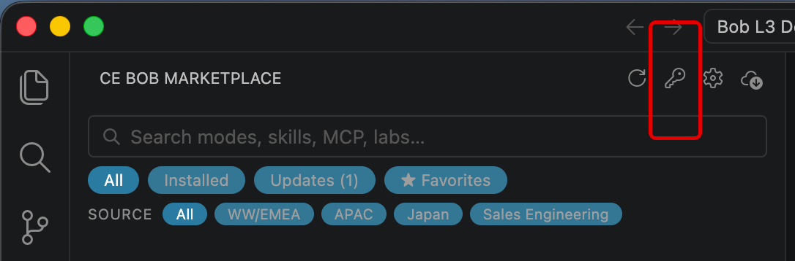

---

3. The prompt window is awaiting a decision to `Set token for which repository?` with drop-down menu appearing below with various options you can choose from.

    Click (or use your keyboard up and down arrows to highlight, followed by ++return++) the `https://github.ibm.com/ClientEngineering/bob` option.

    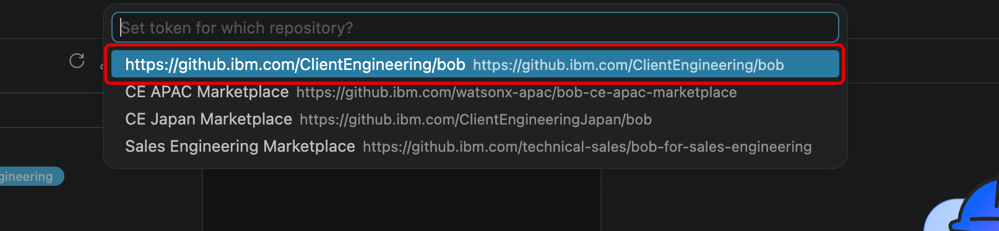

---

4. Next you will be asked to provide the personal access token recorded in section *v*, *Step 3*.

    Paste the token into the context window and press ++return++ to confirm.

    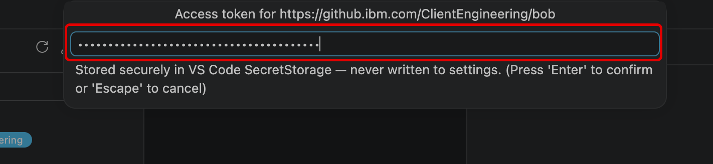

---

Once fully authenticated and authorized, the **CE Bob Marketplace** tab will render a complete inventory of available assets such as:

- Collections
- Modes
- Skills
- Rules
- MCP
- Labs
- Recipes & guides

In order to validate that your environment is fully authenticated, click into any of the categories mentioned above. There should be a substantial number of assets under each category — with these lists (and categories, most likely) expected to grow over time.

With the Marketplace installed, it's now time to prepare and configure the **IBM Pre-Sales Demo Builder**.

---

## **vii. Install the IBM Pre-Sales Demo Builder collection**

Among the *Collections* available on the **CE Bob Marketplace** is the **<a href="https://github.ibm.com/ClientEngineering/bob/tree/main/Collections/IBM-Demo-Builder" target="_blank">IBM Pre-Sales Demo Builder</a>** collection, which provides one-click setup for building credible IBM-grade demos quickly and is the primary focus of this hands-on lab. This will be the tool that you use to rapidly craft IBM product demonstrations, stay on-message with your client demo, and drastically cut down on preparation time ahead of every client engagement.

---

1. From the Bob IDE, click into the **Explorer** tab and then select **Open Folder**.

    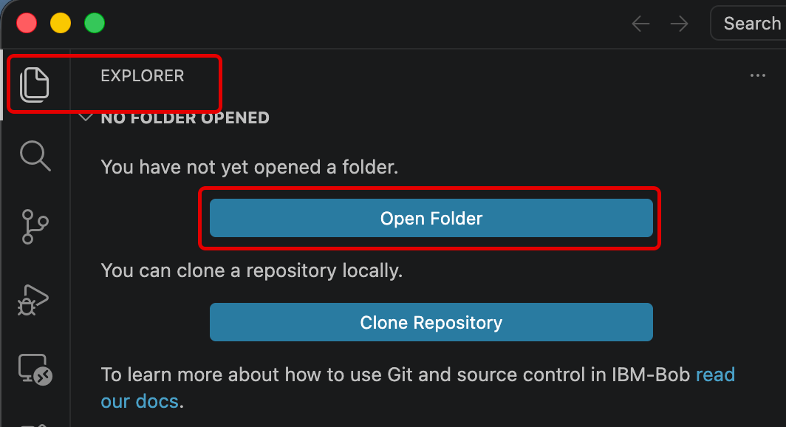

---

2. Create a **New Folder** on your local machine in a directory of your choosing.

    - Name the directory something recognizable, such as `Bob Demo Builder`
    - When ready, click **Create** to finalize the new directory
    - If the Bob IDE has not automatically opened the `Bob Demo Builder` directory, click **File > Open Folder...** from the top menu bar and then select the new directory. 

    Open the newly-created folder to expose its contents (which at this time are empty) within the **Explorer** tab.

    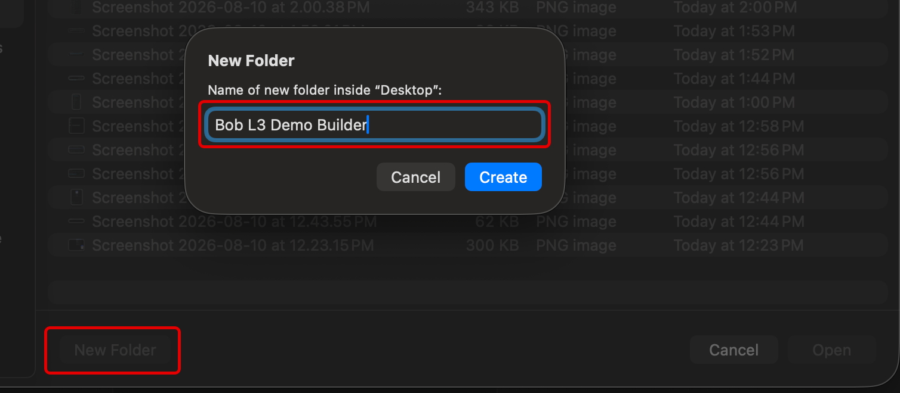

    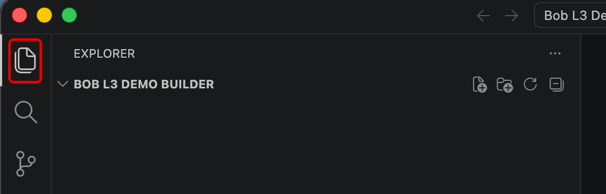

    !!! warning "RESTRICTED MODE"
        When opening a new directory, the Bob IDE may automatically enable **Restricted Mode** which will lock-out extensions (like the **CE Bob Marketplace**) and executables from access until such restrictions are lifted.

        If you are unable to locate the **CE Bob Marketplace** tab along the left-hand side of the Bob IDE interface, look for a blue highlighted **Restricted Mode** shield icon in the bottom-left corner of the IDE.

        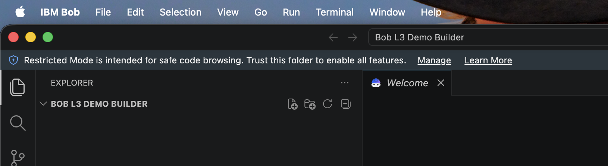{ width="450" }

        To remove the restrictions and expose the CE Bob Marketplace tab:

        - Click the **Restricted Mode** button to pull open the configuration screen
        - Examine the two options under the *You are in Restricted Mode* panel: `In a Trusted Folder` and `In Restricted Mode`
        - Click the **Trust** button under the `In a Trusted Folder` option to disable restrictions
        - Click the ++x++ icon in the top-right corner of the panel to return to the main Bob IDE dashboard

        With the **Restricted Mode** limitations disabled, the **CE Bob Marketplace** button should be restored to the left-hand tabs of the Bob IDE.

        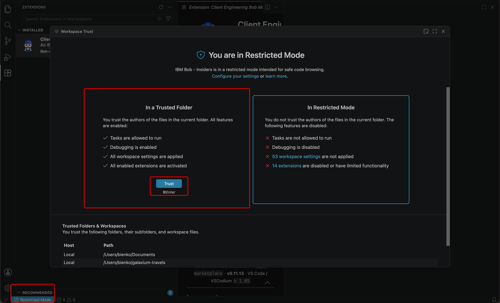

---

3. Click the newly-exposed **CE Bob Marketplace** tab from the left-hand side of the Bob IDE interface.

---

4. At the top of the panel is a search bar. Enter the following to filter from the various collections and assets:

    ```
    IBM Pre-Sales Demo Builder
    ```

    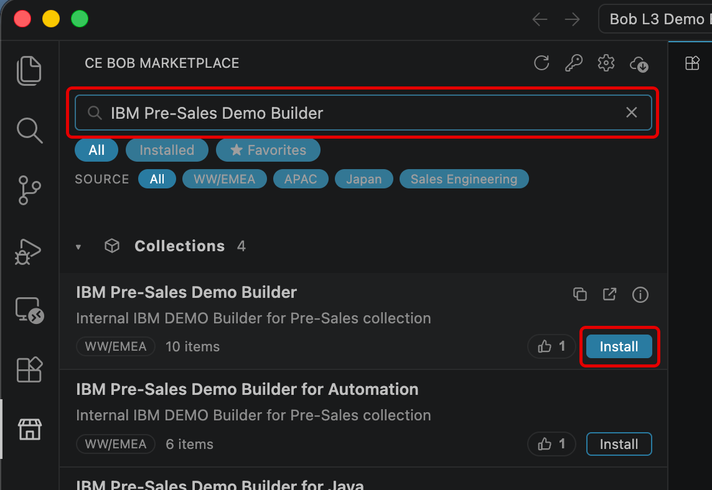

---

5. Click the **Install** button next to the item that *exactly matches* the search filter. Note that there are multiple *Pre-Sales Demo Builders* available (*...for Automation*, *...for Java*, etc.) in the Marketplace.

    For the purposes of this hands-on lab, you will be utilizing the `IBM Pre-Sales Demo Builder` collection only.

---

6. When prompted `Install 10 items from IBM Pre-Sales Demo Builder?`, confirm by clicking **Install**.

    Wait for the **Installing...** icon to switch back to **Install** before advancing to the next step. This is a misleading quirk of the UI, we know. Installation time is approximately `1 minute`.

    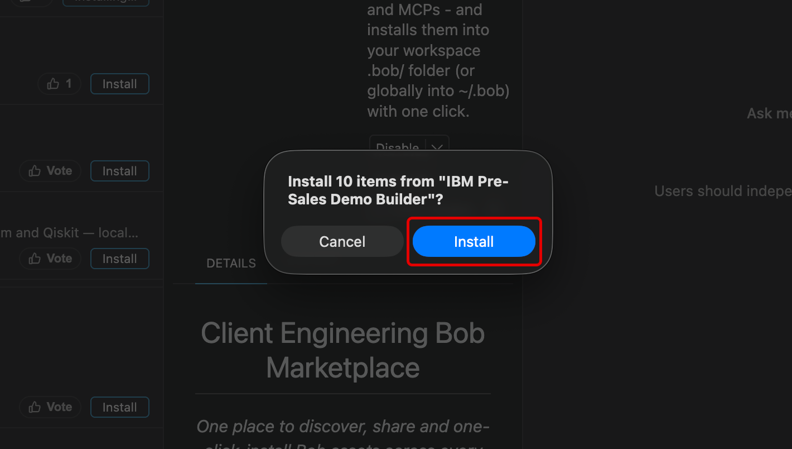

---

7. To verify that the collection has been installed, click the **Explorer** tab once again.

    - Examine the contents of the `Bob Demo Builder` folder, which should now contain a **`.bob`** directory
    - Click the ++greater++ arrow to the left of `.bob` to expand the directory contents: `rules`, `skills`, `mcp.json`

    These directories contain all of the components needed to complete this hands-on lab and demo-builder exercises.

    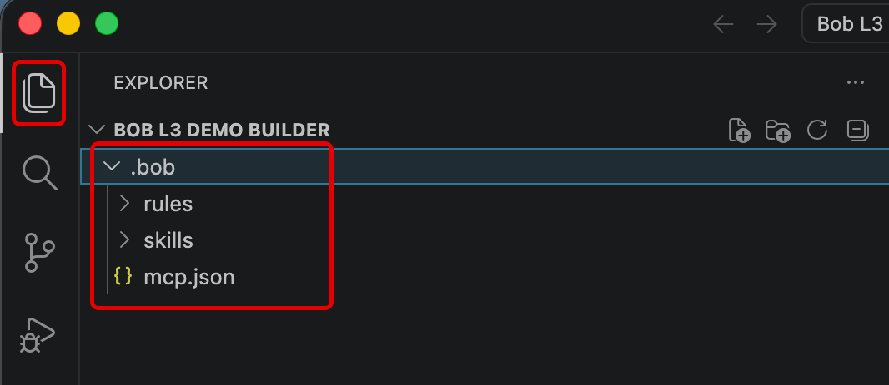

---

To summarize your work so far, at this stage you have:

- Installed the **CE Bob Marketplace**
- Created a **GitHub personal access token** and linked it to the Marketplace
- Installed the **IBM Pre-Sales Demo Builder** collection

Continue to section *viii* to verify the workspace.

---

## **viii. Verify the workspace**

Before any demo work begins, confirm that the workspace is trusted and that the Demo Builder mode is available to the Agentic Sidebar.

---

1. Check the bottom-left corner of the IDE for a blue **Restricted Mode** shield icon. If it is showing, the workspace has been opened in Restricted Mode and the Demo Builder's assets will not load. Click the shield and choose **Trust** under the `In a Trusted Folder` option, exactly as described in section *vii*, *Step 2*.

---

2. Within the **Explorer** tab, confirm that the `Bob Demo Builder` folder contains a **`.bob`** directory. Expand it to find `rules`, `skills`, and `mcp.json`.

---

3. Open the **Agentic Sidebar** (click the **Open Bob** icon at the top of the interface) and click the **mode selector** button to expand the list of available modes. You will find **IBM Pre-Sales Demo Builder** loaded and ready to use.

    Leave the mode set to **Agent** for now. You will switch into the Demo Builder mode at the start of the next chapter.

    <p align="left">
    
    </p>

---

!!! success "READINESS CHECK"

    Before proceeding, verify each of the following items:

    - Client Engineering Bob Marketplace icon is visible
    - GitHub API token is configured
    - Marketplace catalog loads successfully and its *Modes* and *Skills* (as well as its *MCP* servers) are visible
    - The workspace is trusted (no *Restricted Mode* shield in the bottom-left corner)
    - The workspace contains a `.bob` directory with `rules`, `skills`, and `mcp.json`
    - The *IBM Pre-Sales Demo Builder* mode is listed within the Agentic Sidebar's mode selector

!!! warning "A WORD ON WORKING WITH GENERATIVE AI"

    IBM Bob is powered by generative AI and LLMs, and a defining trait of these systems is that they are *non-deterministic* — unlike the *deterministic* tools most developers are accustomed to. In practice, that means the same prompt can produce different code from one run to the next. This is both a strength and a quirk of the technology, and it is something to work *with* rather than against.

    **Precision is what tips the odds in your favor.** The more clearly you describe what you want, the more closely Bob's output will mirror your intent; conversely, the smallest change in wording can meaningfully change the generated code. Throughout this lab, your results may differ from the solutions shown — and that is expected, not a defect. Whenever an output diverges, you have three good options: refine the prompt and try again, edit the generated code by hand, or simply proceed if the variation still compiles and runs. Human review remains essential at every step, and never more so than while you are still learning the tool.


---

## **ix. Optional: Connect the Carbon and TechZone MCP servers**

The Demo Builder collection references two MCP servers:

- **Carbon** (IBM's design system)
- **TechZone** (environment provisioning and documentation)

This section is **optional**. The mock-mode build documented in the next chapter completes without either server configured — the Business Partner route has always been built that way. Configure them now if you intend to take the Demo Builder beyond this lab into live builds and client environments; otherwise, skip ahead to section *x*.

Each server requires short-lived credentials for access — three in total, which you (the user) will gather in the steps ahead and store within a separate document (such as Notepad) for later use:

| CREDENTIAL | ACQUIRED FROM |
|------------|---------------|
| **Carbon Authorization Code** | The Carbon MCP IBMid flow (*detailed in the steps below*) |
| **Carbon Session ID** | The Carbon MCP IBMid flow (*generated alongside the Authorization Code*) |
| **TechZone API token** | Your TechZone profile page (*detailed in the steps below*) |

---

1. To create your Carbon MCP authorizations, navigate to the following website using your web browser:

    !!! warning ""
        **<a href="https://carbondesignsystem.com/developing/carbon-mcp/onboarding-and-setup/" target="_blank">https://carbondesignsystem.com/developing/carbon-mcp/onboarding-and-setup/</a>**
        
    <p align="left">
    
    </p>

---

2. Scroll down to the **<a href="https://www.carbondesignsystem.com/getting-started/carbon-mcp/onboarding-and-setup#token-and-session-id" target="_blank">Token and session ID</a>** section of the page.

    Click the **Generate a token and session ID** button to open a new tab.

---

3. The web browser will be redirected to the usual IBM sign-in page. **Authenticate** with your IBMid credentials.

    <p align="left">
    
    </p>

---

4. Review and accept the Carbon MCP Terms of Use, then click **Continue**.

    <p align="left">
    
    </p>

---

5. **Copy and record *BOTH*** the `Authorization Code` and `Session ID` strings before closing this browser window. These values will not be retrievable once the window or tab is closed.

    Click the overlapping squares icon next to the *Authorization code* box to **copy it** to a clipboard.

    <p align="left">
    
    </p>

---

6. Paste your **Carbon Authorization code** within a separate document (such as Notepad) for reference later.

    <p align="left">
    
    </p>

---

7. Click the overlapping squares icon next to the *Session ID* box to copy it to the clipboard.

    <p align="left">
    
    </p>

---

8. Paste your **Carbon Session ID** within the document (such as Notepad) for later use.

    <p align="left">
    
    </p>

---

9. Lastly, generate an **IBM Technology Zone API key**.

    - Open a **new tab** within your web browser and navigate to **<a href="https://techzone.ibm.com" target="_blank">https://techzone.ibm.com</a>**
    - If prompted to do so, check the box for **I have read and accept the terms and conditions** followed by the **Submit** button
    - In the top-right corner of the page, click the **profile picture icon** to pull open a drop-down menu

    <p align="left">
    
    </p>

---

10. Within the drop-down menu that appears, click **My profile**.

    <p align="left">
    
    </p>

---

11. Click the overlapping squares icon next to the *API token* box to copy it to the clipboard.

    <p align="left">
    
    </p>

---

12. Paste your **Tech Zone API token** within the document (such as Notepad) for reference later.

    <p align="left">
    
    </p>

---

13. With all of the necessary credentials generated and recorded, the MCP servers can now be configured.

    Activate the **Agentic Sidebar** by clicking the **Bob** icon at the top of the IDE interface (just to the right of the search bar.)

---

14. Use the **Mode toggle** button to activate **Agent** mode.

    !!! quote ""
        Notice that the newly-added Pre-Sales Demo Builder mode is also visible at this point (section *viii*, *Step 3*) — but don't use it yet.

---

15. Copy the following prompt to your clipboard. Before executing the instruction within the Agentic Sidebar, **modify Lines 2 through 4** to replace each `your-key` placeholder with the actual credentials gathered and stored earlier.

    - `Carbon Authorization Code` : Step 5
    - `Carbon Session ID` : Step 7
    - `TechZone API Key` : Step 11

    When ready, paste the modified prompt into the Agentic Sidebar and press ++return++ to execute the instruction.

    ``` linenums="1" hl_lines="2 3 4"
    Help me setup the Carbon and TechZone MCP servers. Here are my credentials:
    Carbon Authorization Code: your-key
    Carbon Session ID: your-key
    TechZone API Key: your-key
    ```

    <p align="left">
    
    </p>

---

16. With Bob in **Agent Mode** and the prompt carrying your real credentials, click **Send** or press ++return++ to execute.

    Bob will immediately begin working on configuring the MCP servers to the credentials you provided.

    !!! warning "EXPECT SOME VARIABILITY AHEAD"
        The majority of participants will likely encounter the same prompts as are documented ahead — but we can't guarantee this will be the case with all users. For example, those that have already worked with Bob extensively up to this point may have already performed similar actions before or previously granted permissions that are otherwise requested for the first time (in the steps ahead).

---

17. Bob will await input on a *Tools awaiting approval* checkpoint for `Use Skill carbon-mcp`.

    Click the **Approve for task** button to expedite the number of approvals you must evaluate for this task's execution.

    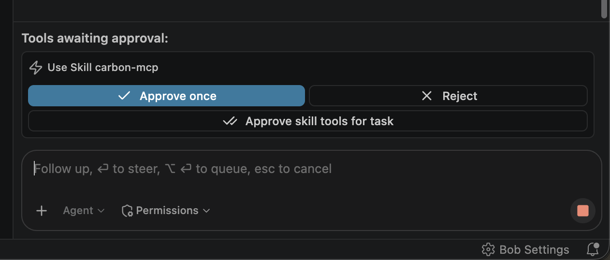{ width="450" }


---

!!! quote "AGENTIC SIDEBAR OUTPUT"
    ```
    Now let me check the existing MCP config to understand the current state before making changes.

    Used skill configure-mcp

    No existing .bob/mcp.json yet. Let me also check the global config and look at the skill config files for the exact URLs.
    ```

18. Bob will attempt to invoke the `configure-mcp` Skill, which on initial attempts will likely fail. In response, Bob will present you with another *Tools awaiting approval* checkpoint for an *Execute Command* action: `ls ~/.bob/settings/mcp.json 2>/dev/null && cat ~/.bob/settings/mcp.json || echo "NOT_FOUND"`

    Click the **Approve for task** button to expedite the number of approvals you must evaluate for this task's execution.

    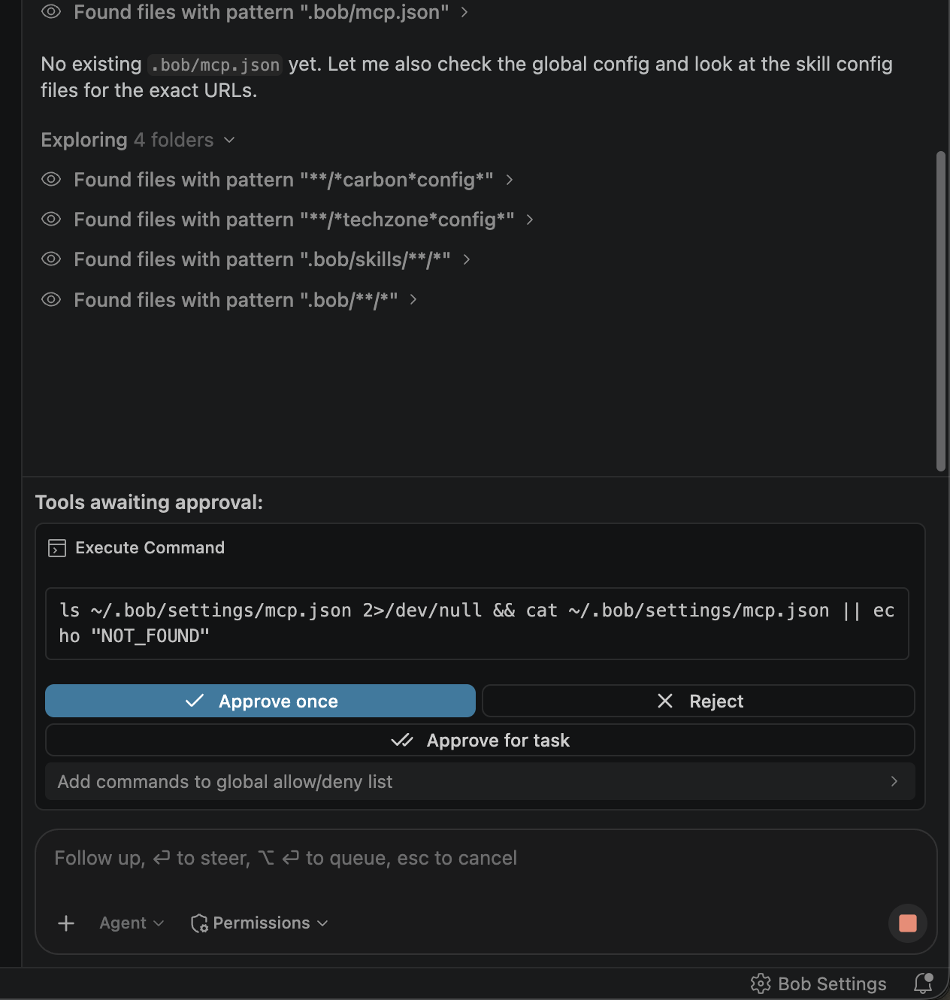{ width="450" }

---

!!! quote "AGENTIC SIDEBAR OUTPUT"
    ```
    The global config exists but is empty. Now I have everything I need.
    
    I'll write the workspace .bob/mcp.json with both servers — Carbon (streamable-HTTP with the JWT and session ID) and TechZone (streamable-HTTP with the API key as a header).
    ```

19. Bob will request permission to invoke the *Update Todo List* tool to perform two different tasks:

    - Write `.bob/mcp.json` with Carbon MCP and TechZone MCP server entries
    - Write TechZone API key to `techzone-key.txt` for reference

    Click the **Approve todo tools for task** button to expedite the number of approvals you must evaluate for this task's execution.

    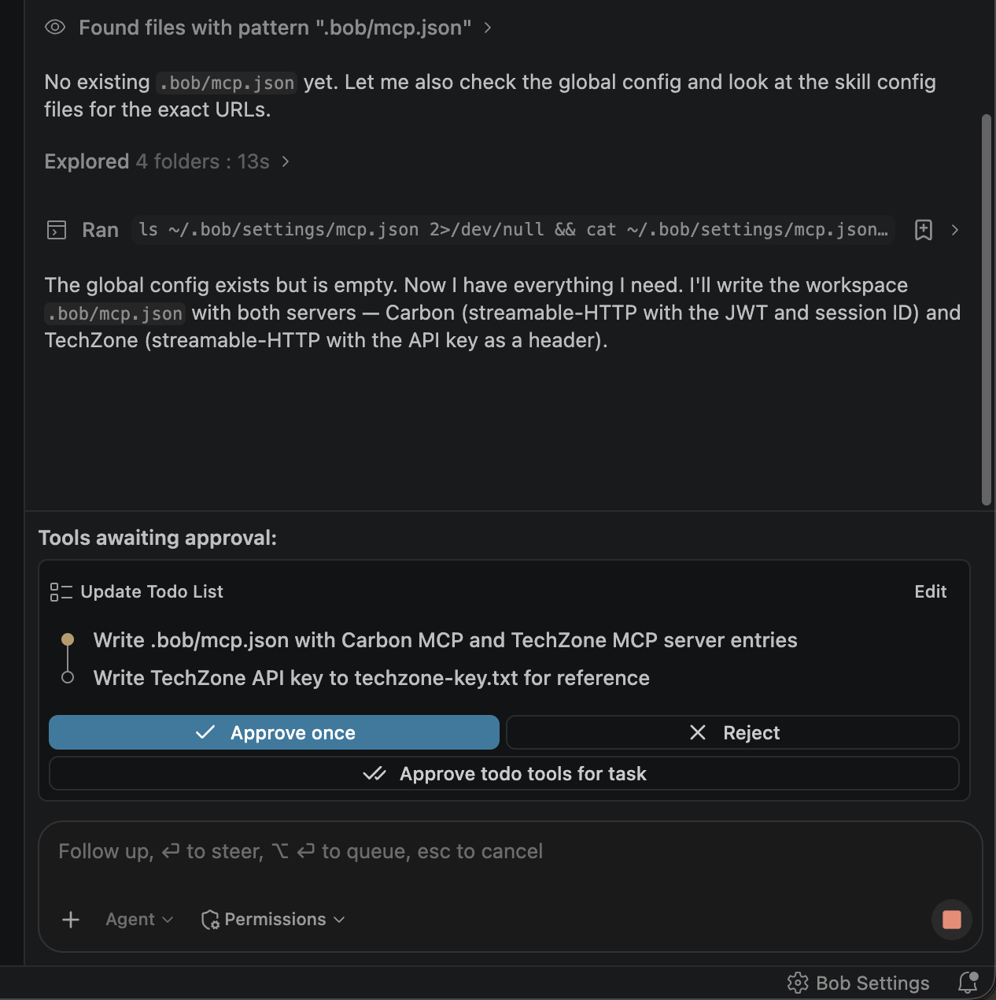{ width="450" }

---

20. Bob will now attempt to write `.bob/mcp.json` with Carbon MCP and TechZone MCP server entries.

    Click the **Approve edit tools for task** button to expedite the number of approvals you must evaluate for this task's execution.

    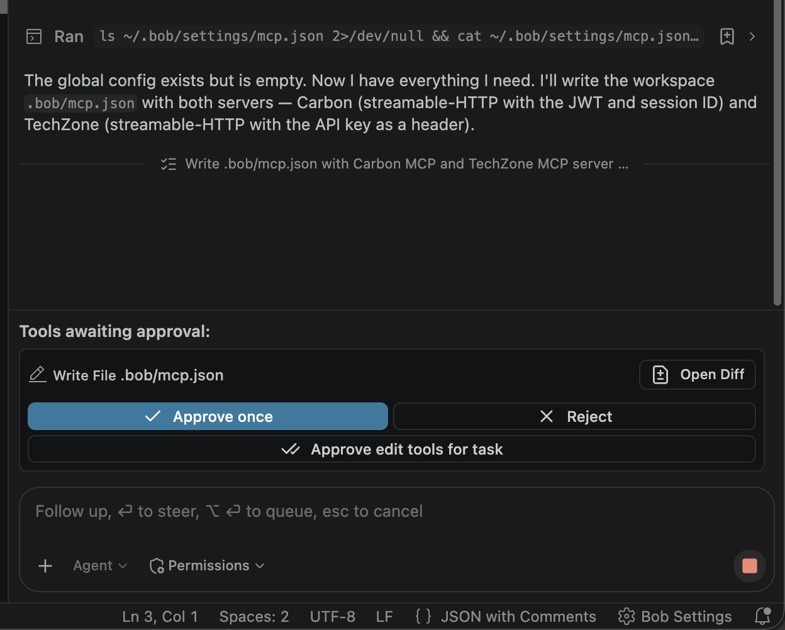{ width="450" }

---

!!! quote "AGENTIC SIDEBAR OUTPUT"
    ```
    All four servers are correctly in place. Now write the TechZone key reference file...

    Both servers are configured. Here's a summary of what was written to .bob/mcp.json...
    ```

21. When the task execution has wrapped up, Bob will report back that `All tasks completed` successfully. A summary (similar to what is documented in the screenshot below) will be presented in-line via the Agentic Sidebar session.

    Additionally, you can inspect the contents of the `mcp.json` file that was newly-created within the **Project** directory. Double-click on the asset to review its contents and to better understand how MCP was configured for the Carbon and IBM Technology Zone endpoints.

    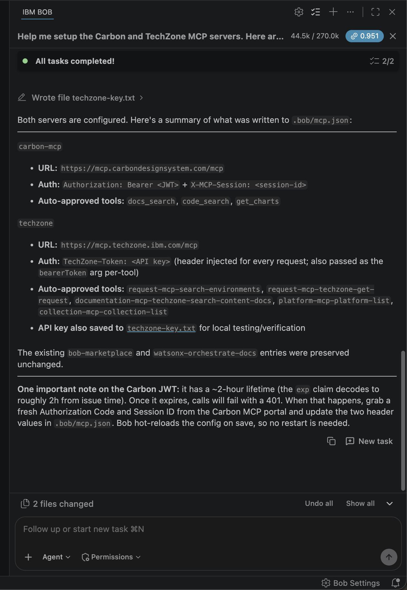{ width="450" }

    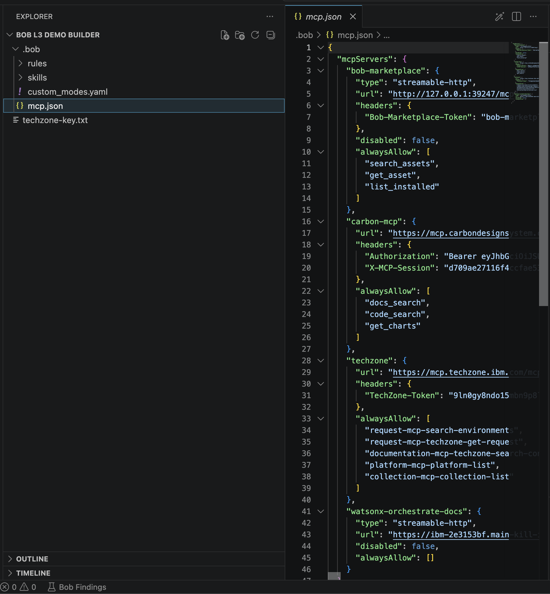{ width="450" }

---

22. **Verify** that the MCP servers have been properly configured with the following actions:

    - Within the bottom-right corner of the Agentic Sidebar, locate and click on the **Bob Settings** icon
    - From the tabs along the left side of the pop-up panel, click the **MCP** option
    - Confirm that each of the following is registered and labeled as *"Connected"* within the table of MCP servers:

        - `techzone`
        - `bob-marketplace`
        - `watsonx-orchestrate-docs`
        - `carbon-mcp`

    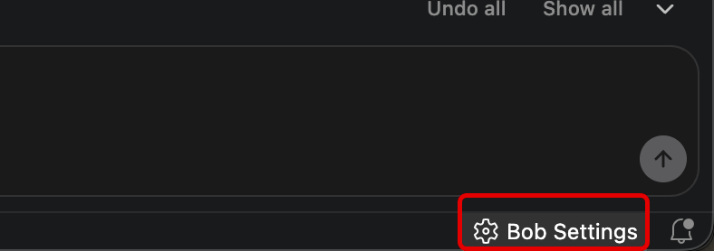{ width="450" }

    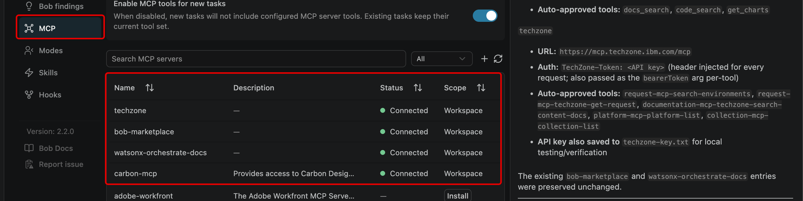{ width="450" }

---

23. Finally, refresh IBM Bob to ensure the MCP servers will work for the tasks ahead. In the top search bar, type:

    ```
    > reload window
    ```

    Click the **"Developer: Reload Window"** button from the drop-down options.

    <p align="left">
    
    </p>

---

## **x. Key takeaways**

---

!!! success "READINESS CHECK"

    Before proceeding, verify each of the following items:

    - The workspace is trusted (no *Restricted Mode* shield in the bottom-left corner)
    - The workspace contains a `.bob` directory with `rules`, `skills`, and `mcp.json`
    - The *IBM Pre-Sales Demo Builder* mode is listed within the Agentic Sidebar's mode selector

- **Internal registration** grants a general-purpose IBM Bob account tied to your w3id. Approval takes 24+ hours, and the Premium Packages are requested separately (they play no part in this lab).
- The **CE Bob Marketplace** is the distribution channel for Client Engineering's packaged assets. The Marketplace itself installs as a `.vsix` extension; the *Modes*, *Skills*, and *Rules* it distributes are installed into your project workspace.
- Downloading an installer script and **reading it before running it** is the habit Bob modelled during the Marketplace install. The script installs one extension and prints (but never transmits) your Bob login email.
- A **GitHub PAT** (with `repo` scope and a 90-day expiry) is the key that unlocks the Marketplace catalog; store it within a password manager and expect to refresh it periodically.
- Installing the **IBM Pre-Sales Demo Builder** places 10 items — a complete `.bob/` folder of *Rules* and *Skills* alongside the Mode and its MCP configuration — into your project workspace.
- Validate the workspace (trusted folder, `.bob` directory, and the Demo Builder mode visible in the selector) **before** any demo work begins.
- The **Carbon** and **TechZone** MCP servers are optional for this lab. Three short-lived credentials power them: the **Carbon Authorization Code** and **Session ID** on one side and the **TechZone API token** on the other. When *MCP* calls misbehave, regenerating fresh credentials is the first remedy to attempt. A **Developer: Reload Window** refresh after MCP configuration ensures the servers register cleanly.

</br>
With the environment assembled and validated, you will next put Bob to work: transforming a one-sentence use case into a running, client-ready demonstration.

---
