**BOB DEMO-BUILDER MODE**
# **BUSINESS PARTNERS | SETUP AND REGISTRATION**

---

## **i. Overview**

!!! note ""
    Christopher Bienko *(AI Enablement GTM Product Manager)* provides an overview of the *Business Partner pathway* for the Bob Demo Builder hands-on enablement. **<a href="https://ibm.seismic.com/Link/Content/DCpChJjbfjGTC8qPp7g8X9pJpFpP" target="_blank">[3 min]</a>**

This page is written for **IBM Business Partners**. IBM regular employees should follow the companion page, **[IBMers | Setup and registration](1-1.md){:target="_blank"}**, which registers internally and installs the Demo Builder from the Client Engineering Bob Marketplace.

The Business Partner route is **fully self-contained**. The internal CE Bob Marketplace, the GitHub personal access token, and the MCP credentials that IBMers configure are **not required** here. Within this chapter, you will assemble the Bob Demo-Builder environment in three stages:

- Register for **IBM Bob** by requesting an *IBM Bob Enterprise* entitlement through **IBM Technology Zone**, then authenticate the Bob IDE on your local machine
- Download the **IBM Pre-Sales Demo Builder** as a packaged workspace from **IBM Seismic**: the Mode together with its Skills, Rules and MCP configuration — pre-loaded and ready to open
- Verify the workspace, so that the *IBM Pre-Sales Demo Builder* mode is available within the Agentic Sidebar before any demo work begins

Both routes arrive at the same working demonstration in the next chapter.

---

## **ii. Prerequisites**

Ensure that you have each of the following prerequisites in hand before embarking on the lab setup. Two minutes of checks now will save you an hour of troubleshooting later.

!!! success "BEFORE YOU BEGIN"
    - Valid **IBMid** credentials (the same IBMid you use to sign in to IBM Technology Zone)
    - Administrative rights to install software on your local machine
    - Access to **IBM Seismic** for the packaged download in section *iv*

    No Intranet or VPN connection is required.

!!! warning "ALREADY HAVE IBM BOB?"
    If the Bob IDE is already installed and authenticated on your machine (through a Free Trial account, for example), skip section *iii* and jump ahead to section *iv*. Any authenticated IBM Bob account can run the Demo Builder.

---

## **iii. Request an IBM Bob Enterprise entitlement**

Business Partners register for IBM Bob through **IBM Technology Zone**, which provisions an *IBM Bob Enterprise* entitlement against your IBMid. The same TechZone collection also serves the *Premium Package* entitlements (for i, for Z, and for Java); only the Enterprise entitlement is needed for this lab.

---

1. Requests for IBM Bob Enterprise entitlements are made via **IBM Technology Zone**. Visit the following collection to begin the process:

    !!! warning ""
        **URL: <a href="https://techzone.ibm.com/collection/bob-business-partner-enablement/environments" target="_blank">https://techzone.ibm.com/collection/bob-business-partner-enablement/environments</a>**

    From the left-hand side of the page, click the **Environments** tab.

    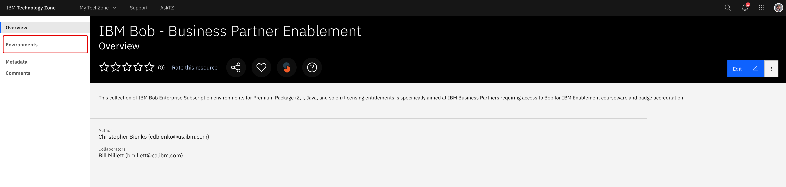{ width="600" }

---

2. Four options will be available:

    - *Request entitlement for IBM Bob Enterprise*
    - Request entitlement for IBM Bob Premium Package for i
    - Request entitlement for IBM Bob Premium Package for Z
    - Request entitlement for IBM Bob Premium Package for Java

    Click the **Reserve it** button below the *Request entitlement for IBM Bob Enterprise* tile.

    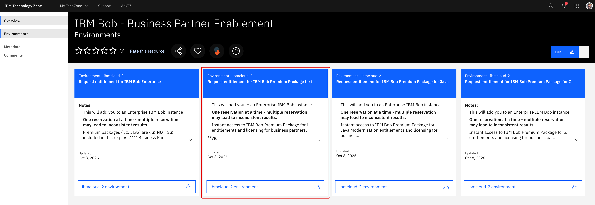{ width="600" }

---

3. *Step 1: General* of the configuration process will ask you to specify a **Name** and **Description** for your reservation. When ready, click **Next** in the bottom-right corner to continue.

    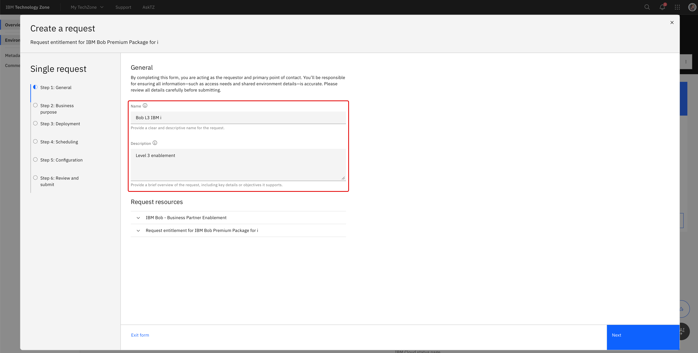{ width="600" }

---

4. *Step 2: Business purpose* must be set to **Learning**. When ready, click **Next** to continue.

---

5. *Step 3: Deployment* will ask you to specify the **Geography** for your deployment. Select the data center location that is closest to you. When ready, click **Next** to continue.

    { width="600" }

---

6. *Step 4: Scheduling* will ask you to specify the go-live and termination dates for your entitlement. Choose a window that comfortably covers the time you expect to spend on this lab. If the entitlement lapses before you finish, you can submit a new request using these same instructions. When ready, click **Next** to continue.

    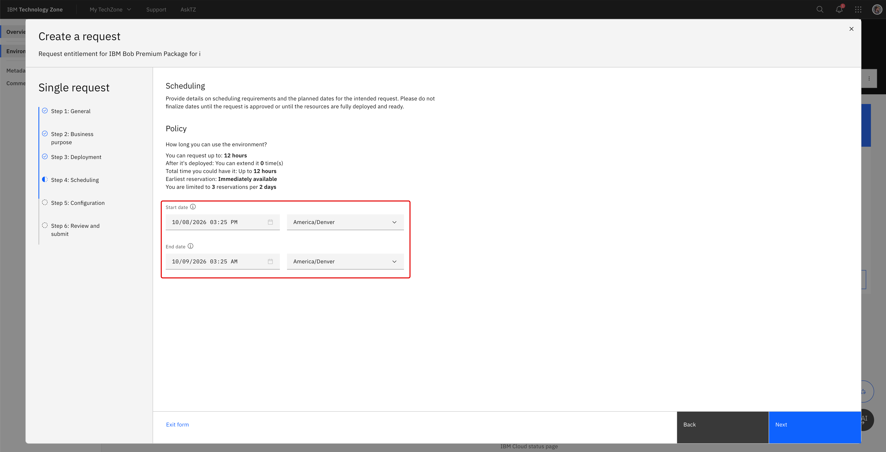{ width="600" }

---

7. *Step 5: Configure* can be left **blank** (default state of *"There is nothing to configure here."*) When ready, click **Next** to continue.

    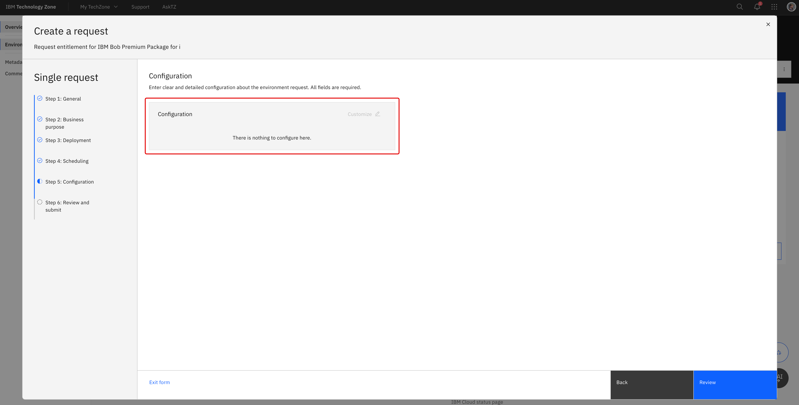{ width="600" }

---

8. *Step 6: Review and submit* will ask you to review your configuration settings before submitting the request. Scroll down through your reservation details and, if you approve, check the **I agree to IBM Technology Zone's terms & conditions and user security policies.** box at the bottom of the page. When ready, click **Submit** to initiate the reservation request.

    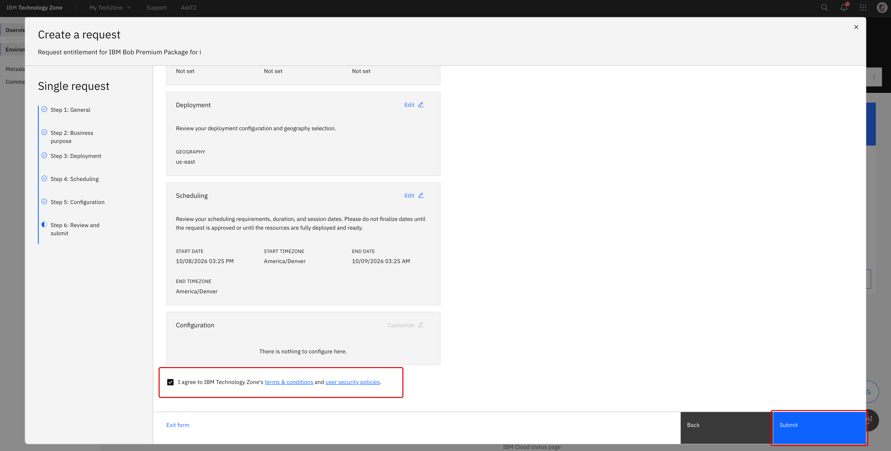{ width="600" }

---

9. The web browser will redirect automatically to IBM Technology Zone's *My requests* dashboard. From this page, you can monitor and track the progression of your reservation request as it moves from `Scheduled` to `Provisioning` to `Ready`. **Wait** until the request is marked as `Ready` before advancing.

    Average deployment times are roughly **`5 minutes`** or less.

    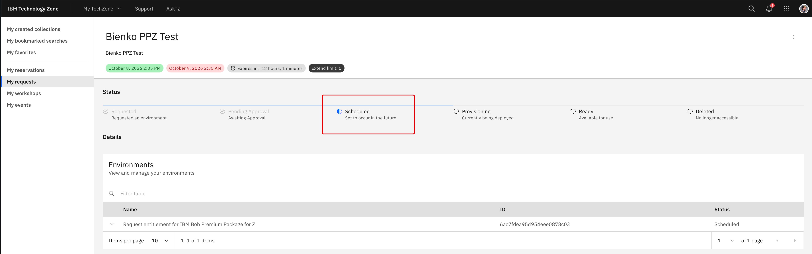{ width="600" }

    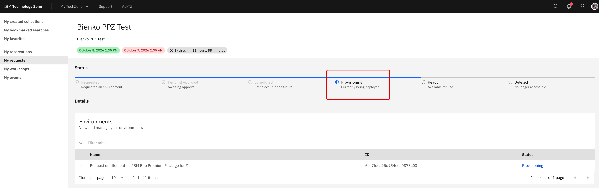{ width="600" }

    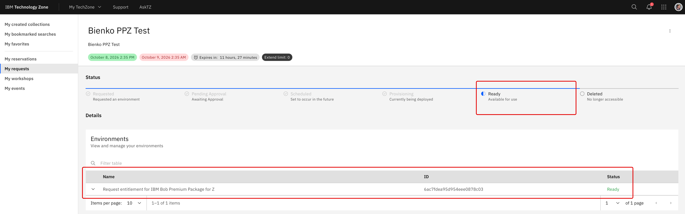{ width="600" }

---

10. When the reservation is `Ready`, you will receive an email to your inbox providing you with a link to the environment **and** the same details will also be accessible via the *My requests* dashboard (where you were tracking the reservation request).

    Click either the **View your request** link in the email body *OR* click the arrow to the left of your reservation name on the *My requests* dashboard to expand details about the request.

    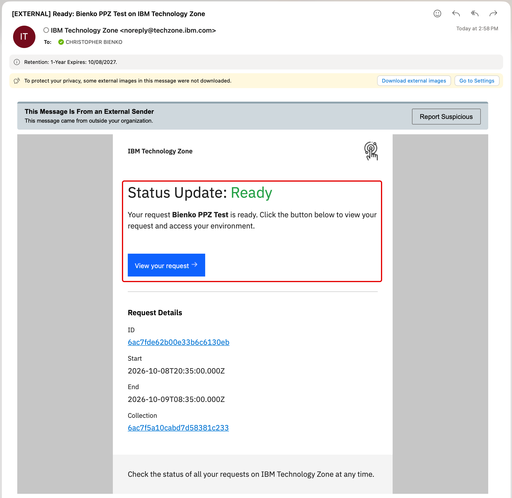{ width="600" }

    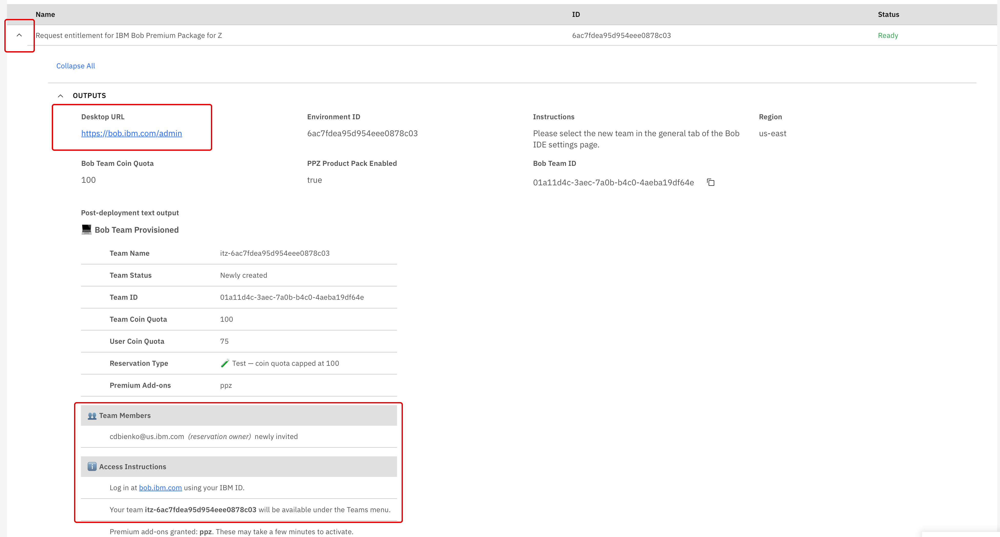{ width="600" }

---

11. Both links will direct to the IBM Bob dashboard:

    !!! warning ""
        **URL:** **<a href="https://bob.ibm.com/admin" target="_blank">https://bob.ibm.com/admin</a>**

    Authenticate and log in using your **IBMid** — the same one you used to sign in to IBM Technology Zone. The entitlement you just requested is associated with it.

---

12. The web browser will redirect to a welcome splash screen reading *"Welcome [your username]!"* where you are prompted to **Choose workspace**.

    If you previously registered for IBM Bob by another route (such as a *Free Trial*), the default option below this may display text such as `Free Trial` or something else entirely.

    - Click the box below **Choose workspace** to open a drop-down menu
    - Your request via IBM Technology Zone will have added a new option to this list, similar to `TECHZONE-BobathonV2 (us-east)`: this is your newly-provisioned IBM Bob Enterprise entitlement
    - Select the `TECHZONE-...` option as your workspace and then continue with the login

    !!! warning "EXACT WORDING VARIES BY REGION"
        The label of the workspace depends on the geography you selected in *Step 5* and may not read exactly as it does in the screen capture. Look for the option prefixed with `TECHZONE`.

    { width="600" }

---

13. The web browser will automatically load into the IBM Bob dashboard.

    - Verify in the top-left corner that the `TECHZONE-...` workspace is selected for **Organization**
    - Click the **Subscription** tab to view your plan type and seat count, as well as your Bobcoin balance

---

14. If the Bob IDE is not yet installed on your machine, **<a href="https://bob.ibm.com/download" target="_blank">download and install</a>** it now. Select the version that matches your operating system.

    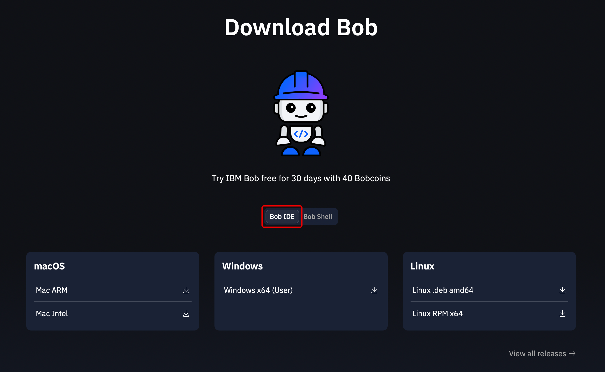{ width="600" }

---

15. Open the Bob IDE and press **Log in to Bob**.

    

    
    

---

16. Press **Allow** on the pop-up window, followed by **Open** on the subsequent pop-up window.

    

    
    

    

    
    

---

17. On the IBM Verify sign-in page, expand the *"Choose an option"* drop-down and press **IBMid.** Sign in with the same IBMid that you used on IBM Technology Zone.

    

    
    

---

18. You should be redirected to an **"Authentication Successful!"** screen.

    Afterward, **return to the tab with IBM Bob open** and press **Open** on the new window that has appeared on the IBM Bob screen. Look to the Agentic Sidebar — the window for entering prompts has opened. You have now successfully accessed your authenticated IBM Bob account.

    

    
    

    

    
    

    

    
    

---

19. One last check binds the IDE to your entitlement. Look towards the bottom-right corner of the Bob IDE interface. Along the bottom edge of the interface there will be an interactable button labelled **Bob Settings** — click this button to open the *Settings* panel.

    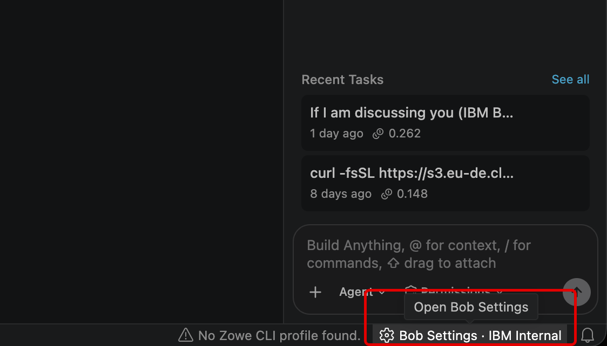{ width="600" }

---

20. From the *Settings* panel, make sure the **General** tab (left side) is the one being displayed.

    - Locate the **Team** setting, which by default at this stage might be set to `Trial` or some other variation
    - Click the name of your **Team** to pull open a drop-down menu
    - Select the `TECHZONE-...` option to connect the IDE to your IBM Bob Enterprise entitlement

    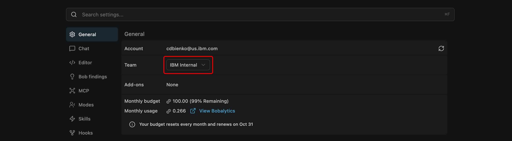{ width="600" }

    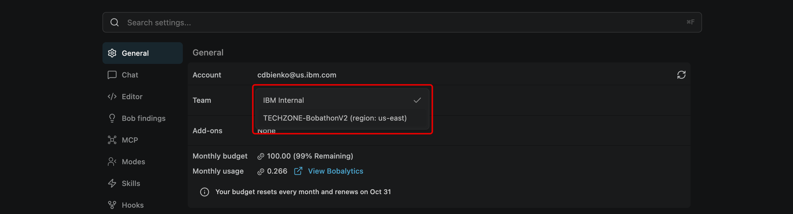{ width="600" }

---

With IBM Bob authenticated and bound to your entitlement, continue to section *iv* to download the Demo Builder.

---

## **iv. Download the Demo Builder package from Seismic**

The Demo Builder arrives as a packaged download from IBM Seismic, with everything pre-loaded and ready to use. Neither the CE Bob Marketplace nor a GitHub personal access token is required.

---

1. Download the **IBM-Pre-Sales-Demo-Builder.zip** file from the following location:

    !!! warning ""
        **<a href="https://ibm.seismic.com/Link/Content/DCMhGH8HMFdJ2G4QRdFjDJT6m438" target="_blank">https://ibm.seismic.com/Link/Content/DCMhGH8HMFdJ2G4QRdFjDJT6m438</a>**

    

    
    

---

2. Once downloaded, locate the file and double-click to begin extraction.

    

    
    

---

3. Extract the **IBM-Pre-Sales-Demo-Builder** `.zip` file to a directory (of your choosing) on your local machine.

    

    
    

    

    
    

---

4. Return to the IBM Bob IDE. If it is not already open, click **Explorer** (++ctrl+shift+e++) to open the file explorer panel within the IDE.

    

    
    

---

5. Click **Open Folder**.

    

    
    

---

6. Locate the extracted version (*Step 3*) of the Pre-Sales Demo Builder and select it. For Windows, this most likely landed within your *Downloads* folder.

    Click **"Select folder"** to confirm the choice.

    !!! warning "SELECT THE EXTRACTED VERSION"
        Ensure you select the **unzipped** version — the resulting folder produced after you pressed *Extract all*!

    

    
    

---

With the unzipped folder now open within the IBM Bob IDE, continue to section *v* to verify the workspace.

---

## **v. Verify the workspace**

Before any demo work begins, confirm that the workspace is trusted and that the Demo Builder mode is available to the Agentic Sidebar.

---

1. Check the bottom-left corner of the IDE for a blue **Restricted Mode** shield icon. When opening a new directory, the Bob IDE may automatically enable **Restricted Mode**, which locks out extensions and executables until such restrictions are lifted. The Demo Builder's assets will not load while it is active.

    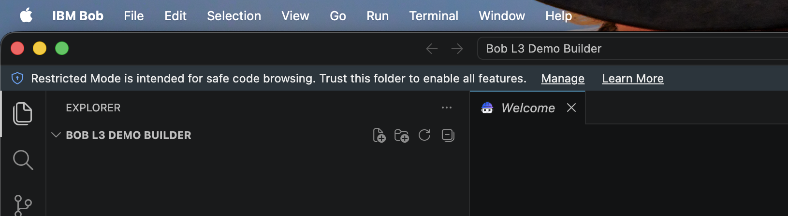{ width="450" }

    To remove the restrictions:

    - Click the **Restricted Mode** button to pull open the configuration screen
    - Examine the two options under the *You are in Restricted Mode* panel: `In a Trusted Folder` and `In Restricted Mode`
    - Click the **Trust** button under the `In a Trusted Folder` option to disable restrictions
    - Click the ++x++ icon in the top-right corner of the panel to return to the main Bob IDE dashboard

---

2. Within the **Explorer** tab, confirm that the extracted `IBM-Pre-Sales-Demo-Builder` folder contains a **`.bob`** directory. Expand it to find `rules`, `skills`, and `mcp.json`. These directories contain all of the components needed to complete this hands-on lab and demo-builder exercises.

---

3. Open the **Agentic Sidebar** (click the **Open Bob** icon at the top of the interface) and click the **mode selector** button to expand the list of available modes. You will find **IBM Pre-Sales Demo Builder** loaded and ready to use.

    Leave the mode set to **Agent** for now. You will switch into the Demo Builder mode at the start of the next chapter.

    

    
    

---

## **vi. Key takeaways**

---

!!! success "READINESS CHECK"

    Before proceeding, verify each of the following items:

    - The workspace is trusted (no *Restricted Mode* shield in the bottom-left corner)
    - The workspace contains a `.bob` directory with `rules`, `skills`, and `mcp.json`
    - The *IBM Pre-Sales Demo Builder* mode is listed within the Agentic Sidebar's mode selector

- Business Partners register for IBM Bob by requesting an **IBM Bob Enterprise** entitlement through IBM Technology Zone: *Business purpose* set to **Test** and the nearest geography, with a `TECHZONE-...` workspace appearing at `bob.ibm.com/admin` within minutes.
- The entitlement is bound to the Bob IDE through **Bob Settings → General → Team**; select the `TECHZONE-...` option there.
- The **Business Partner route** is fully self-contained: a packaged download from Seismic, unzipped and opened within the Bob IDE, with the *IBM Pre-Sales Demo Builder* mode pre-loaded. No Marketplace, GitHub token, or MCP credentials are required.
- Open the **extracted** folder in the Bob IDE — the one produced by *Extract all* — rather than the `.zip` file itself.
- Validate the workspace (trusted folder, `.bob` directory, and the Demo Builder mode visible in the selector) **before** any demo work begins.

 
With the environment assembled and validated, you will next put Bob to work: transforming a one-sentence use case into a running, client-ready demonstration.

---
