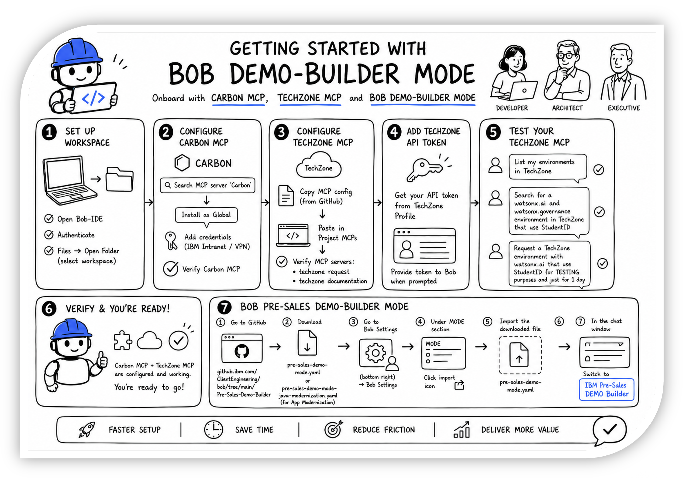

**BOB DEMO-BUILDER MODE**
# **INTRODUCTION**

---

## **i. The AI Maturity Curve at work**

!!! note ""
    Christopher Bienko *(AI Enablement GTM Product Manager)* introduces the *Client Engineering Bob Marketplace* and *IBM Bob Demo-Builder Mode* curriculum for hands-on enablement. **<a href="https://ibm.seismic.com/Link/Content/DCT8C8hMXQVqB8CC49mQfDc3VW93" target="_blank">[2 min]</a>**

Every seller has encountered the demo trade-off. A bespoke demonstration is persuasive, but consumes weeks of scarce technical talent. Alternatively, a canned demonstration is instant, but generic. Enterprise audiences will recognize the difference quickly.

**IBM Bob Demo-Builder Mode** is designed to collapse that trade-off. It scales *expertise*, rather than headcount: the method of IBM's best client engineers, captured once as a Mode, applied by any practitioner, on any opportunity, within a single working session.

The Demo-Builder Mode you will explore in the chapters ahead is a packaged Bob *Custom Mode* built and maintained by IBM Client Engineering. It captures the methodology applied by a senior solution engineer as a reusable asset. That asset carries a persona and a build lifecycle, together with decision gates and compliance guard-rails. It also carries the product knowledge required to embed IBM platforms into a real full-stack solution.

!!! warning ""
    The outcome? A **working, compliant, runnable client demonstration** — produced in hours rather than weeks.

A core hallmark of the **AI Maturity Curve** is that IBM Bob *always* ensures that the user (you), the human-in-the-loop, maintains control and understanding throughout every interaction. The modules within the hands-on lab work ahead will further reinforce those notions: putting that maturity to work against the most valuable artifact in the pre-sales motion.

---

!!! quote ""
    The graphic above serves as your map for this hands-on lab and the work ahead: register for IBM Bob; install the **IBM Pre-Sales Demo Builder Mode** (from the CE Bob Marketplace for IBMers or as a packaged download from Seismic for Business Partners); optionally configure the **Carbon** and **TechZone** MCP servers; and, from that point onward, *you're ready to build*. Notice that the asset types being wired together here— MCP servers for reach, a Mode for method —are the very extensibility concepts introduced within **<a href="https://ibm.github.io/bob-l3/scale/4-1/" target="_blank">Module 4 | Scale & Extend</a>**. This lab is where those concepts will concretely come together into real-world, client-facing capabilities.

---

## **ii. Why this matters**

---

The discipline you practiced in the **<a href="https://ibm.github.io/bob-l3/" target="_blank">IBM Bob Level 3 "Climbing the AI Maturity Curve"</a>** labs carries over into this content as well: **Bob does the building; the human (you) ultimately keeps hands on the controls.**

The Demo Builder asks crisp and targeted questions at genuine decision points — and works autonomously between them. Those decision points span use case identification and product fit, environment details and build path, and compliance.

!!! note "WHAT IS THE AI MATURITY CURVE?"
    If this concept is new to you, the authors highly recommend checking out the **<a href="https://ibm.github.io/bob-l3/" target="_blank">IBM Bob Level 3 "Climbing the AI Maturity Curve"</a>** courseware. Many **<a href="https://yourlearning.ibm.com/activity/PLAN-5AA8FE9E4A6D" target="_blank">IBMers</a>** and **<a href="https://learn.ibm.com/course/view.php?id=18804" target="_blank">Business Partners</a>** will have already taken this as part of their pre-requisite learning paths on generative AI coding assistants and IBM Bob. However, if you've missed it, there's no better time than the present to understanding how IBM Bob aligns with an enterprise organization's journey along the curve. The material and topics covered within the learning plan will greatly inform and enrich the concepts covered within the modules ahead.

The user remains in the decision seat the entire journey. What changes is the output: each session concludes with a demonstration you can place in front of a real-world client.

---

## **iii. What's in this course**

---

| CHAPTER | TOPIC | WHAT YOU'LL TAKE AWAY |
|---------|-------|------------------------|
| [**1a. Setup and registration — IBMers**](1-1.md){:target="_blank"} | Register internally and install the CE Bob Marketplace; create your GitHub PAT; install the Demo Builder collection into a fresh workspace | A fully configured Demo Builder environment, validated end-to-end |
| [**1b. Setup and registration — Business Partners**](1-2.md){:target="_blank"} | Request an IBM Bob Enterprise entitlement through IBM Technology Zone and download the packaged Demo Builder from Seismic | The same validated environment, with no Marketplace, GitHub token, or VPN required |
| [**2. Deploying with demo builder**](2.md){:target="_blank"} | Brief the Demo Builder, approve the autonomous build, and launch a mock-mode demo end-to-end | A complete, runnable client demonstration — and the repeatable per-demo workflow |
| [**3. Prompting best practices**](3.md){:target="_blank"} | The use case brief: six things every prompt must answer | Briefs that produce client-ready demos in a single session, without re-prompting |
| [**4. Deployment strategies**](4.md){:target="_blank"} | The asset model behind the Demo Builder: Modes, Skills, MCPs, and Rules | The operating philosophy to carry into a C-suite conversation about agentic AI |
| [**5. Leveraging asset templates**](5.md){:target="_blank"} | Authoring your own Modes, Skills, and Rules from the official templates | The ability to extend the asset library yourself — correctly, the first time |

---

## **iv. Before you start**

---

Recall the closing note from <a href="https://ibm.github.io/bob-l3/scale/4-3/" target="_blank">**Module 4 | Scale & Extend**</a>, which previewed a dedicated series of hands-on labs covering the **IBM Bob Marketplace** and the **Model Context Protocol (MCP)**, as well as their synergies with IBM Technology Zone client-facing demonstrations. The hands-on work ahead assumes you have completed the core curriculum of that L3 course, or that you hold equivalent familiarity with the Bob IDE and the Agentic Sidebar as well as Custom Modes and MCP.

However, to simplify the work, your environment will begin as a fresh workspace. You will **not** need any code or repositories from the previous lab on your machine in order to complete the following lab. Nothing from the *Galaxium Travels* environment carries over into this one.

---

What you ***do*** need:

!!! success "REQUIREMENTS"
    - **IBM Bob** installed and authenticated — Chapter 1 has a registration page for each audience
    - Your **IBMid** credentials are at hand (IBM regular employees sign in with their w3id)
    - **IBM regular employees:** you can sign in to **<a href="https://github.ibm.com" target="_blank">github.ibm.com</a>** and you are connected to the **IBM Intranet** (or via Cisco AnyConnect VPN)
    - **Business Partners:** you can reach **IBM Seismic** to download the packaged Demo Builder
    - A local folder is available to serve as your Bob project workspace

    No additional downloads or staged files are required before you begin.

!!! warning "BUSINESS PARTNERS"
    **Business Partners** register for IBM Bob through IBM Technology Zone and follow their own Setup page, **[Business Partners | Setup and registration](1-2.md){:target="_blank"}**. That route is fully self-contained and requires neither *github.ibm.com* access nor an Intranet VPN connection.

---

## **v. Next steps**

---

In the chapter ahead, you will register for IBM Bob and obtain the IBM Pre-Sales Demo Builder — IBM regular employees via the Client Engineering Bob Marketplace and Business Partners via the Seismic package — before verifying a fresh workspace ahead of any demo work.